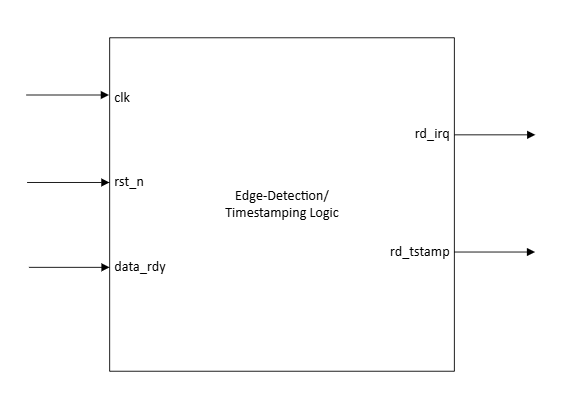

# Sensor Fusion Unit - Embedded System Prototype
## Description
Subsea vehicles such as ROVs and AUVs are equipped with various sensors used for determining the vehicle's heading and orientation or for visually mapping out the surrounding subsea environment.  However, an issue arises when that time-dependent mapping is generated strictly according to processor time as opposed to real sample arrival time.  In the former case, handling this data only in software introduces considerable misalignment between sensor readings and ultimately renders the reported state of the vehicle useless to the receiving device or end user.  Specifically, a station-keeping system may take this faulty state as input to compare where the vehicle is currently positioned to where it should be and adjust accordingly.  As a result, the faulty state input propagates considerable error to the comparison causing the wrong adjusting maneuver to be carried out by the system.  

To address this time discrepancy between measurements and ultimately improve on the control of these underwater vehicles, a system-on-chip (SoC) solution will be explored for this design.  Digital logic will be used to incorporate hardware interrupts and timestamping to determine the precise arrival time of sensor data, and the processing system will be used for multithreaded tasking, software interrupts and the fusion algorithm required to transmit a complete state vector of the vehicle’s position, velocity and orientation in real time.  Initial prototyping and proof of concept will be executed with Digilent’s Zybo Z7-10 (or 20, depending on availability) development board which is equipped with the Xilinx Zynq-7000 SoC.  Developing on this chip allows for Free Tier use of AMD's Vivado and Vitis for both hardware and embedded software design while providing the capability to acquire and process data from at least a few sensors via SPI/UART/etc.  

The desired outcome of this project is to demonstrate the ingestion of real (and/or simulated, depending on hardware availability) readings from a variety of subsea sensor inputs and show that the resulting output state vector is in an acceptable format for the applicable vehicle.  Upon conclusion of this design, an extension to accept and fuse visual data with inertial data on the SFU for environmental mapping shall be explored.  

## Required Equipment/Software
* Digilent Zybo Z7-10/20 Development Board (Xilinx Zync-7000 SoC)
* Micro USB Cable
* Sensors of choice (ex. Inertial Measurement Unit and simulated DVL strings for vehicle orientation)
* Python for generating test inputs

## System/Module Design
System Architecture Block Diagram

[Sensor Fusion - Software Block]

## Design Verification
[Test Cases]
